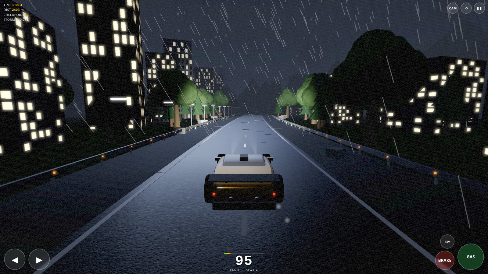
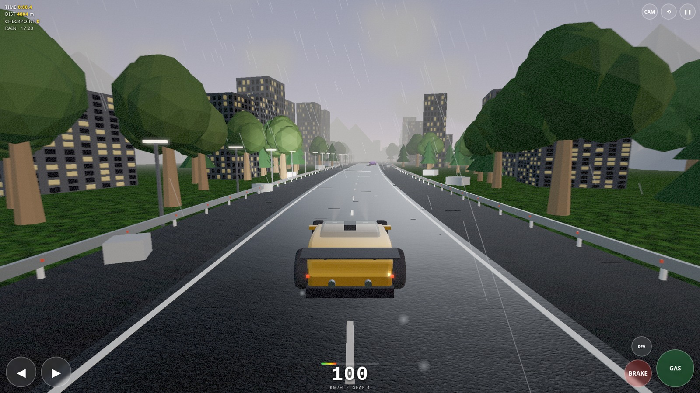
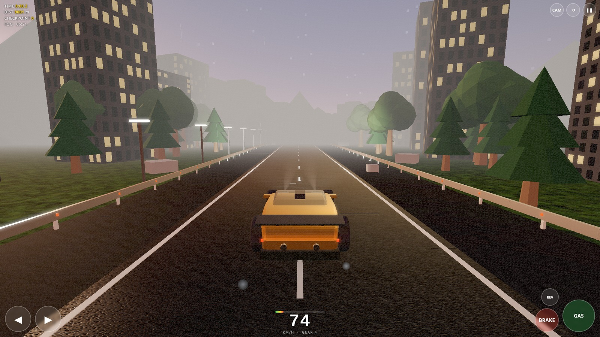
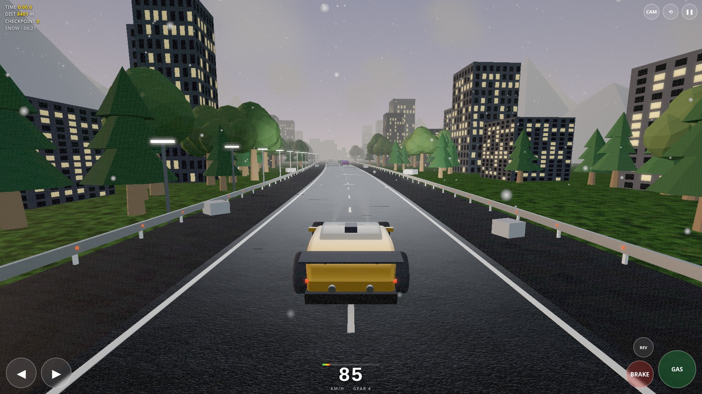
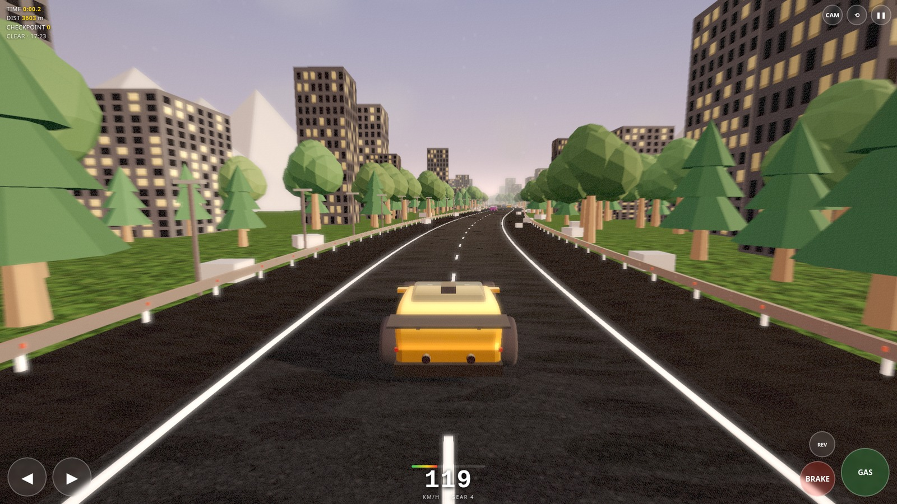
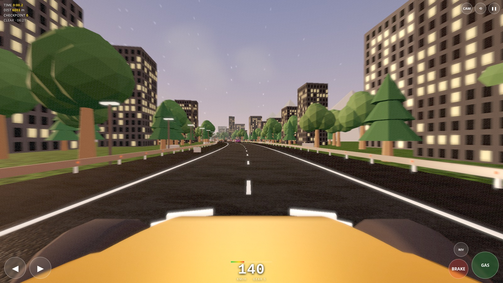

# Voxel Racing

A complete 3D racing game in **one HTML file** — procedural highway, dynamic weather, day/night cycle, real vehicle physics and post-processed rendering. No build step, no server, no internet required. Runs in the browser and ships as an Android APK.

## Screenshots

All captured in-game at **1920×1080, Ultra quality**, landscape.

| | |
|---|---|
|  **Storm · Night** — lightning, wet reflective tarmac, lit windows |  **Rain · Dusk** — rain streaks, spray, glowing street lamps |
|  **Fog · Dawn** — headlights cutting through the mist |  **Snow · Dawn** — falling snow, low-grip surface |
|  **Clear · Dusk** — golden hour on the highway |  **Hood cam** — 140 km/h, 78° FOV |

## Features

**Graphics**
- Physically based materials — clearcoat car paint, glass, chrome, environment reflections from a generated PMREM sky
- HDR sky shader with sun disc, atmospheric gradient and stars at night
- Bloom, motion blur, vignette and film grain post-processing
- Real-time shadows, procedural asphalt with bump/roughness maps, lit building windows at night

**Weather & time**
- Six weather states: Clear, Cloudy, Rain, Storm, Snow, Fog — all smoothly interpolated
- Wet roads change grip: **1.25 µ dry → 0.95 µ in a storm**, and the tarmac turns dark and reflective
- Lightning flashes with thunder, rain streaks, snow, spray and dust particles
- Full day/night cycle: Dawn, Noon, Dusk, Night or Auto — headlights switch on automatically

**Driving**
- Longitudinal + lateral tyre model with slip angles, load transfer, weight shift and aero drag
- 6-speed automatic gearbox, traction limit, ABS-style braking, stability control
- Guardrail collision that guides the car along the rail instead of stopping it dead
- Suspension pitch/roll/bounce, skid marks, brake lights, traffic AI, checkpoint timing

**Engine**
- Single self-contained file — Three.js is embedded, everything else is generated at runtime (textures, geometry, sky, audio)
- Quality presets: Low / Medium / High / Ultra with adaptive resolution
- Procedural engine, tyre and rain audio via WebAudio

## Play

**Browser** — open `index.html`. That's it.

**Android** — install `apk/VoxelRacing.apk` (Android 5.0+, signed, works offline). You'll need to allow "Install unknown apps" for your file manager, since it is self-signed.

## Controls

| Action | Keyboard | Touch |
|---|---|---|
| Accelerate | `↑` / `W` | GAS |
| Brake | `↓` / `S` / `Space` | BRAKE |
| Steer | `←` `→` / `A` `D` | ◀ ▶ |
| Reverse | `↓` / `S` | REV |
| Camera | `C` | CAM |
| Reset car | `R` | ⟲ |
| Pause | `P` / `Esc` | ❚❚ |
| Weather | `N` | Menu → Weather |
| Time of day | `T` | Menu → Time of Day |

## Tech

- [Three.js r128](https://threejs.org) (MIT) embedded inline
- Custom bloom pipeline (bright pass → separable blur → composite with vignette, grain and radial speed blur)
- Procedural everything: canvas textures, extruded car bodywork, instanced roadside scenery
- ~1,700 lines of JavaScript, no dependencies to install

## Notes

- The game is landscape-only by design; rotate the device.
- On older phones pick **Medium** quality in the menu for a smoother frame rate.
- The APK is self-signed with a local key — fine for sideloading, not for Play Store distribution.
